<picture>
  <source media="(prefers-color-scheme: dark)" srcset="./dark.svg">
  <source media="(prefers-color-scheme: light)" srcset="./light.svg">
  
</picture>

## Hi, I'm Sandeep Midde 👋

**Technology & Delivery Leader** · **Platform Modernization** · **Applied AI**

🚀 Building GenAI products · 🏦 Modernizing regulated platforms · 🧭 Delivery governance

I've spent about 20 years modernizing legacy platforms in highly regulated environments, redesigning
mission-critical systems for compliance, resilience and scale. These days I design and ship GenAI
systems end to end: RAG, agentic workflows and knowledge platforms.

---

### 🧭 Focus

- **Platform modernization**: legacy ERP to cloud-hosted platforms, event-driven integration, API layers
- **Applied AI / GenAI**: RAG, prompt engineering, AI guardrails and evaluation, multi-model architecture
- **Delivery & governance**: architecture guardrails, risk and compliance (COSO, CMMI Level 5), Agile/SAFe, DR and audit readiness

### 💼 Experience

| Role | Where | When |
|---|---|---|
| Independent AI Technical Product Development | Independent | Jul 2026 – present |
| Vice President | Wells Fargo India | Oct 2012 – Jun 2026 |
| Staff Consultant | Oracle India | Aug 2011 – Sep 2012 |
| Technology Architect | Infosys | Jul 2006 – Jul 2011 |

At Wells Fargo I led technical strategy and platform governance for a $2.5T+ AUM finance ecosystem.
That work included a build-vs-buy case that cut projected TCO from $4M to $1.2M, a Kafka-fed Python
computation layer that turned a 3-hour workflow into under 2 minutes, and a RAG feasibility study
with its own evaluation harness.

### 🛠️ Featured projects

| Project | What it is |
|---|---|
| [**Krishna Uvaca**](https://sandeepmidde.com/posts/krishna-uvaca/) | RAG-based conversational AI: context-aware retrieval, grounded answers, multi-turn memory |
| [**ObserverPrime**](https://sandeepmidde.com/posts/observer-prime/) | Agentic workflow automation: multi-stage pipelines, provider-agnostic LLMs, resumable runs |
| [**Elara**](https://sandeepmidde.com/posts/project-elara/) | AI knowledge management: turns saved PDFs, links and notes into searchable knowledge cards |
| **ApplyPilot** | Local-first job-search assistant: multi-source job discovery, AI fit scoring, ATS keyword match, cloud autopilot |

### ⚙️ Engineering stack

**AI / GenAI:** RAG · LangChain · ChromaDB · Prompt engineering · AI guardrails & evaluation · Responsible AI  
**Engineering:** Python · Kafka · REST / Apigee · Event-driven architecture · TOGAF / SOA · Playwright  
**Platforms:** PeopleSoft · Oracle · Salesforce · Azure  
**Delivery:** CI/CD (Git, Jenkins, uDeploy, Harness) · Jira · Agile / SAFe

### 🎓 Education & certifications

Post Graduation - IIIT Bangalore

MBA - ICFAI

Graduation - BITS-Pilani, Rajasthan

**Certifications:** PMP · Microsoft Azure AZ-900 · AI Security & Governance (Securiti) · Salesforce Agentblazer Champion 2026 · Enterprise Product Management Fundamentals (Microsoft) · Oracle Certified PeopleSoft Technical Consultant

### ✍️ Writing

- [Agentic AI Is Rewriting the PMO Playbook](https://sandeepmidde.com/posts/agentic-ai-in-project-management/)
- [AI Agents Move Into Production](https://sandeepmidde.com/posts/ai-agents-move-into-production/)
- [Observer Prime: Unified Agentic Orchestration](https://sandeepmidde.com/posts/observer-prime/)
- [Project Elara: Contextual Knowledge OS](https://sandeepmidde.com/posts/project-elara/)
- More on [sandeepmidde.com/blog](https://sandeepmidde.com/blog.html)

### 📊 GitHub contributions

<picture>
  <source media="(prefers-color-scheme: dark)" srcset="https://raw.githubusercontent.com/sandeepmidde/sandeepmidde/output/github-snake-dark.svg">
  <source media="(prefers-color-scheme: light)" srcset="https://raw.githubusercontent.com/sandeepmidde/sandeepmidde/output/github-snake.svg">
  
</picture>

### 📫 Connect

The banner is drawn entirely from text characters and animated with SMIL. `tools/build_banner.py` rebuilds it.
